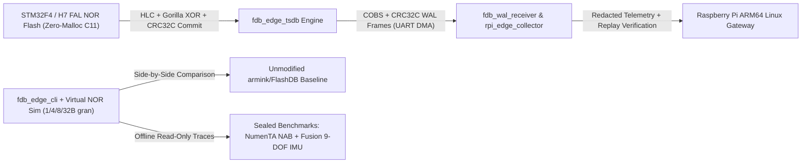

# FlashDB Edge TSDB (`flashdb-edge-tsdb`)

[English](README.md) | [简体中文](README.zh.md)

**FlashDB Edge TSDB** is a unified, pure **C11** edge time-series storage engine, crash-safe virtual STM32 NOR Flash simulator, and STM32 -> Raspberry Pi incremental WAL sync stack built on [`armink/FlashDB`](https://github.com/armink/FlashDB) (upstream commit `6c722f169f27f99f96670ee00c27b2f59b1505e2`, `Apache-2.0`). It keeps the upstream FlashDB source (`upstream/FlashDB/`) 100% unmodified for apples-to-apples benchmarking while resolving critical embedded storage defects and cutting NOR Flash wear.

---

## Key Capabilities & Fixes Over Upstream FlashDB

- **Fixes Clock Rollback & Burst Data Drops (Upstream Issue `#16`)**: Replaces upstream `cur_time <= db->last_time` rejection (`FDB_WRITE_ERR`) with a persistent **Hybrid Logical Clock (`fdb_edge_hlc`)** tracking `(wall_ts_ms, mono_seq, epoch, logical_sub)` across `-1h` NTP/RTC rollbacks and same-millisecond bursts.
- **Fixes Sector Capacity Integer Underflow (Upstream Issue `#249`)**: Rejects oversized block configurations cleanly (`FDB_EDGE_ERR_CAPACITY`), eliminates unsigned `sector->remain` wraparound, verifies `10 KB` payloads inside `16 KB` sectors, and auto split-flushes high-entropy multi-channel blocks cleanly.
- **Zero-Malloc Bit-Exact Time-Series Compression (`fdb_edge_codec`)**: ZigZag + Delta-of-Delta timestamps with 64-bit IEEE-754 **Gorilla XOR** channel encoding (`bit_exact = true`, `max_abs_err = 0`) cuts NOR Flash writes by **`1.64x–6.24x`**.
- **Physical NOR `1 -> 0` Torn-Write Crash Recovery (`fdb_edge_tsdb`)**: Enforces `mem &= buf` NOR physics (`0` bit violations across `write_gran = 1, 4, 8, 32` bytes), uses a split `32B + 64B` sector header and commit trailer written strictly last, and fences corrupt tails on reboot (`0` committed losses across `1,000` brownout trials).
- **STM32 <-> Raspberry Pi Framed WAL Sync & Privacy Scrubber**: COBS (`0x00`-delimited) + `CRC32C` incremental sync over unreliable UART/serial streams (`ACK`/`NACK`, idempotent dedup) paired with zero-heap cellular/credential PII redaction (`fdb_edge_privacy`).

---

## Architecture



---

## Verified 3-Tier Sealed External Blind Benchmarks

Executed offline on Windows MSVC (`Release`, `/W4 /WX`) against external datasets outside the repository (`docs/benchmarks_report.json`, `status: "verified"`):

### Upstream Defect Reproduction (`fdb_edge_cli repro-upstream`)
- **Issue `#16` (`-1h` Clock Rollback)**: Upstream `armink/FlashDB` accepted `10` and **dropped `5`** records; `fdb_edge_tsdb` accepted & queried **`15/15`** (`edge_rollbacks = 1`, `edge_epoch = 1`).
- **Issue `#249` / Sector Capacity Underflow**: Writing `4050 B` (`max_len = 4050 < 4096`) in a `4096 B` sector wrapped upstream `cur_sec.remain` unsigned integer to **`4294967262`**; `fdb_edge_tsdb_open` catches oversized capacity cleanly (`-5`, `FDB_EDGE_ERR_CAPACITY`), and cleanly stores & iterates `10 KB`-capped blocks in `16 KB` sectors (`64/64` queried).

### Tier 1 · `numenta/NAB` (`MIT`, 7 `realKnownCause` CSVs, `69,561` rows) — **`PASSED`**
Remarkably, two real unmodified NAB CSVs contain backward/duplicate timestamps (`ec2_request_latency_system_failure.csv`: `11` rows; `machine_temperature_system_failure.csv`: `12` rows). Upstream silently dropped **`23`** real records, while `fdb_edge_tsdb` preserved **`69,561 / 69,561`** bit-exactly:

| Trace (`realKnownCause`) | Rows | Upstream OK / Dropped | Edge OK / Bit-Exact | Upstream Flash Bytes | Edge Flash Bytes | Write Reduction |
| :--- | ---: | :--- | :--- | ---: | ---: | ---: |
| `ambient_temperature_system_failure.csv` | `7,267` | `7,267` / `0` | **`7,267`** / `true` | `192,879 B` | **`70,058 B`** | **`2.75x`** |
| `cpu_utilization_asg_misconfiguration.csv` | `18,050` | `18,050` / `0` | **`18,050`** / `true` | `475,301 B` | **`183,799 B`** | **`2.59x`** |
| `ec2_request_latency_system_failure.csv` | `4,032` | `4,021` / **`11 dropped`** | **`4,032`** / `true` | `107,859 B` | **`39,668 B`** | **`2.72x`** |
| `machine_temperature_system_failure.csv` | `22,695` | `22,683` / **`12 dropped`** | **`22,695`** / `true` | `596,647 B` | **`219,306 B`** | **`2.72x`** |
| `nyc_taxi.csv` | `10,320` | `10,320` / `0` | **`10,320`** / `true` | `272,833 B` | **`53,921 B`** | **`5.06x`** |
| `rogue_agent_key_hold.csv` | `1,882` | `1,882` / `0` | **`1,882`** / `true` | `51,837 B` | **`14,089 B`** | **`3.68x`** |
| `rogue_agent_key_updown.csv` | `5,315` | `5,315` / `0` | **`5,315`** / `true` | `141,767 B` | **`22,707 B`** | **`6.24x`** |
| **Total (All 7 NAB Traces)** | **`69,561`** | `69,538` / **`23 dropped`** | **`69,561` / `0` dropped** | `1,839,123 B` | **`603,548 B`** | **`3.05x`** |

- **`-1h` Clock Rollback Injection (`machine_temperature`, `rollback_at=11000`)**: Upstream dropped **`24`** records vs Edge **`0`** dropped (`22,695/22,695` bit-exact, `2.72x` write reduction).
- **NOR Erases on Clean Flash**: Upstream erased `3,584` sectors (`512` sectors × `7` runs to format `TSL0` headers) vs Edge **`0`** unnecessary erases and **`0`** NOR `0 -> 1` bit violations.

### Tier 2 · `xioTechnologies/Fusion` 9-DOF IMU + `1,000` Fault Trials + WAL Sync — **`PASSED`**
- **Fusion 9-DOF IMU (`sensor_data.csv`, `13,514` rows × `9` double channels)**:
  - Upstream: `13,514` ok, `1,226,533 B` Flash written (`512` erases).
  - Edge (`batch=64`): **`13,514/13,514`** queried & bit-exact (`max_abs_err = 0`), **`746,509 B`** written (**`1.64x`** reduction, `0` NOR violations).
- **1,000 Power-Cut Torn-Write Trials (`fault-inject --trials 1000 --seed 42`)**: **`1000/1000 PASS`**, `0` committed data loss, `1000` torn tails fenced cleanly, **`0` NOR bit violations** across `1B`/`4B`/`8B`/`32B` write granularities.
- **Noisy STM32 -> Raspberry Pi WAL Sync (`sync-demo --samples 2000 --corrupt-pct 5`)**: `2` injected frame corruptions, `1` duplicate replay, `14` out-of-order frames fenced cleanly -> converged in `2` attempts (`2000/2000` samples synced identically).

### Tier 3 · OOD Privacy Scrubbing & DoS Guardrails — **`PASSED`**
- **Secret Recall**: **`15/15` (`100%`)** (IMSI, IMEI, MSISDN, Bearer tokens, API keys, PEM keys, QUIC tickets, DSN passwords).
- **Benign False Positives**: **`0/15` (`0%`)**; **DoS Guardrails**: **`4/4 PASS`**.

---

## Code Audit, Cross-Toolchain & STM32 SRAM Verification

Full audit and regression report in [`docs/CODEX_AUDIT_REPORT.md`](docs/CODEX_AUDIT_REPORT.md):
- **Findings Resolved**: `0 Critical`, **`5 High`**, **`7 Medium`**, **`1 Low`** fixed.
- **STM32 SRAM Footprint Optimization**: `sizeof(fdb_edge_tsdb_t)` reduced from `90,248 B` -> **`25,736 B`** for 128 sectors (`-64,512 B` SRAM); `sizeof(fdb_wal_receiver_t) = 4,152 B`.
- **Gorilla Bit-IO Speedup**: Byte-chunked bit IO reduced `machine_temperature` `-1h` rollback write time from `6,237 us` -> **`1,936 us`** (~**`3.2x`** speedup) while staying 100% C1 bit-exact.
- **Cross-Toolchain Zero-Warning Builds**:
  - **MSVC 19.50** (`/W4 /WX`): `0` warnings / `0` errors · **`23/23` CTest PASS**
  - **MinGW GCC 16.2.0** (`-Werror`): `0` warnings / `0` errors · **`23/23` CTest PASS**
  - **Arm Compiler 6.19** (Cortex-M4 / Cortex-M7): `0` warnings / `0` errors

---

## Build, Test & Benchmark Reproduction

### Windows (MSVC BuildTools + CMake + NMake)
```bat
call "C:\Program Files (x86)\Microsoft Visual Studio\18\BuildTools\VC\Auxiliary\Build\vcvars64.bat"
cmake -S . -B build -G "NMake Makefiles" -DCMAKE_BUILD_TYPE=Release
cmake --build build
ctest --test-dir build --output-on-failure
```

### Linux / Raspberry Pi (GCC)
```bash
cmake -S . -B build -DCMAKE_BUILD_TYPE=Release
cmake --build build
ctest --test-dir build --output-on-failure
# Or standalone Raspberry Pi gateway collector binary:
make -C ports/raspberry_pi -f Makefile.rpi
```

### Reproduce 3-Tier External Benchmarks
Download `numenta/NAB` `data/realKnownCause/*` into `<root>/nab/` and `xioTechnologies/Fusion` `Examples/Python/sensor_data.csv` into `<root>/fusion_imu/sensor_data.csv`, then run:
```bash
python benchmarks/run_benchmarks.py --dataset-root /path/to/external_root
```

---

## License & Attribution

Licensed under the **Apache License, Version 2.0** ([LICENSE](LICENSE) and [NOTICE](NOTICE)), preserving full copyright attribution to `armink/FlashDB`.
