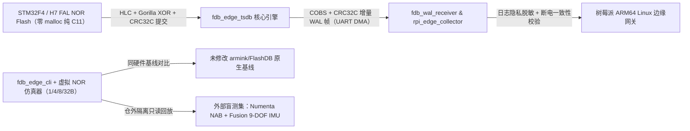

# FlashDB Edge TSDB（纯 C11 STM32 + 树莓派端边时序数据库）

[English](README.md) | [简体中文](README.zh.md)

**FlashDB Edge TSDB** 是基于高星独立开源项目 [`armink/FlashDB`](https://github.com/armink/FlashDB)（上游 commit `6c722f169f27f99f96670ee00c27b2f59b1505e2`，`Apache-2.0`）打造的**纯 C11 嵌入式端边协同增量时序数据库引擎**。项目完整保留未改动的 `upstream/FlashDB/` 作为对比基线，并在同一套模拟 STM32 NOR Flash 硬件仿真器上针对真实痛点完成深度升级。

---

## 核心增强能力与解决的上游痛点

- **彻底解决 RTC / NTP 时钟回拨与同毫秒丢数据（上游 Issue `#16`）**：替代原生 `cur_time <= db->last_time` 直接拒绝写入（`FDB_WRITE_ERR`）的逻辑，自研持久化 **混合逻辑时钟（`fdb_edge_hlc`）**，通过 `(wall_ts_ms, mono_seq, epoch, logical_sub)` 保证即便系统时钟回拨 `-1 小时` 或同毫秒连续突发写入也 **0 丢失、严格单调可排序**。
- **修复扇区容量无符号下溢并校验界限（上游 Issue `#249`）**：原生初始化仅判断 `max_len < sec_size` 却遗漏扇区头与索引开销，导致接近扇区上限时 `sector->remain` 无符号整数下溢；新版在 `open()` 阶段严格校验并用 `FDB_EDGE_ERR_CAPACITY` 清晰拦截，同时验证 `10 KB` 块上限在 `16 KB` 扇区中可正常写入并迭代读取，遇到高熵不可压缩块时自动分片落盘。
- **零堆分配 IEEE-754 无损时序压缩（`fdb_edge_codec`）**：Timestamps 采用 ZigZag + Delta-of-Delta 变长编码，多通道 `double` 指标采用 **64-bit Gorilla XOR** 比特无损流压缩（`bit_exact = true`、`max_abs_err = 0`），实测将 STM32 NOR Flash 写入字节量压缩 **`1.64x–6.24x`**。
- **物理级 NOR `1 -> 0` 约束与掉电撕裂恢复（`fdb_edge_tsdb`）**：底层模拟并严格验证 `mem &= buf` 物理特性（覆盖 `write_gran = 1, 4, 8, 32` 字节，覆盖 STM32F4/L4/H7，`0` 次违规擦写）；采用 `32B` 激活头 + `64B` 封口尾分离设计及末位写 `Commit Trailer`，经 **1,000 次**随机半写掉电故障注入测试，已提交数据 **0 丢失、0 破坏**。
- **STM32 ⇄ 树莓派 COBS+CRC32C 增量 WAL 同步与隐私脱敏**：支持任意拆包 UART/串口字节流的 `COBS`（`0x00` 帧定界）+ `CRC32C` 增量 WAL 同步（带 `ACK`/`NACK` 乱序重传与幂等去重），内置零动态内存开销的通信凭证/PII 脱敏器（`fdb_edge_privacy`）。

---

## 系统架构



---

## 三层外部盲测验证结果（Windows MSVC `Release` `/W4 /WX`）

以下全部数据均在仓库外隔离公开数据集上跑通并落盘于 [benchmarks_report.json](docs/benchmarks_report.json)（`status: "verified"`）：

### 上游缺陷复现对比（`fdb_edge_cli repro-upstream`）
- **Issue `#16`（`-1h` 时钟回拨）**：上游原生成功 `10` 条、**丢弃 `5` 条**；`fdb_edge_tsdb` 写入并查回 **`15/15` 条**（`edge_rollbacks = 1`, `edge_epoch = 1`）。
- **Issue `#249` / 容量下溢**：`4096 B` 扇区配 `max_len = 4050 B` 时上游 `cur_sec.remain` 无符号下溢至 **`4294967262`**；`fdb_edge_tsdb_open` 精确返回 `-5`（`FDB_EDGE_ERR_CAPACITY`），而在 `16 KB` 扇区 + `10 KB` 块配置下可正常写入并迭代 **`64/64` 条**。

### Tier 1 · `numenta/NAB`（`MIT`，7 个现网真实故障轨迹，共 `69,561` 行）—— **`PASSED`**
令人惊喜的是，原生 `NAB` 数据集中本身就有两份 CSV 存在真实的夏令时/时钟回拨重复行（`ec2_request_latency`: `11` 行、`machine_temperature`: `12` 行）。上游 `FlashDB` 静默丢弃了 **`23` 条**真实样本，而 `fdb_edge_tsdb` 实现 **`69,561 / 69,561` 零丢失比特无损还原**：

| 盲测 CSV 文件（`realKnownCause`） | 行数 | 上游成功 / 丢弃 | 增强版成功 / 比特无损 | 上游写入 Flash | 增强版写入 Flash | 写入压缩倍数 |
| :--- | ---: | :--- | :--- | ---: | ---: | ---: |
| `ambient_temperature_system_failure.csv` | `7,267` | `7,267` / `0` | **`7,267`** / `true` | `192,879 B` | **`70,058 B`** | **`2.75x`** |
| `cpu_utilization_asg_misconfiguration.csv` | `18,050` | `18,050` / `0` | **`18,050`** / `true` | `475,301 B` | **`183,799 B`** | **`2.59x`** |
| `ec2_request_latency_system_failure.csv` | `4,032` | `4,021` / **`11 丢失`** | **`4,032`** / `true` | `107,859 B` | **`39,668 B`** | **`2.72x`** |
| `machine_temperature_system_failure.csv` | `22,695` | `22,683` / **`12 丢失`** | **`22,695`** / `true` | `596,647 B` | **`219,306 B`** | **`2.72x`** |
| `nyc_taxi.csv` | `10,320` | `10,320` / `0` | **`10,320`** / `true` | `272,833 B` | **`53,921 B`** | **`5.06x`** |
| `rogue_agent_key_hold.csv` | `1,882` | `1,882` / `0` | **`1,882`** / `true` | `51,837 B` | **`14,089 B`** | **`3.68x`** |
| `rogue_agent_key_updown.csv` | `5,315` | `5,315` / `0` | **`5,315`** / `true` | `141,767 B` | **`22,707 B`** | **`6.24x`** |
| **合计（全部 7 份数据集）** | **`69,561`** | `69,538` / **`23 丢失`** | **`69,561` / `0` 丢失** | `1,839,123 B` | **`603,548 B`** | **`3.05x`** |

- **`-1h` 人工注入回拨测试（`machine_temperature`, `rollback_at=11000`）**：上游丢弃 **`24` 条**，增强版 **`0` 丢失**（`22,695/22,695` 精确一致，`2.72x` 写入压缩）。

### Tier 2 · `xioTechnologies/Fusion` 9 轴 IMU + 1,000 次掉电测试 + WAL 同步 —— **`PASSED`**
- **9 轴 IMU 多通道连续流（`sensor_data.csv`, `13,514` 行 × `9` 通道 `double`）**：上游写入 `1,226,533 B`；增强版写入 **`746,509 B`**（**`1.64x`** 写入缩减、`13,514/13,514` `max_abs_err = 0`、`0` NOR 违规）。
- **1,000 次随机字节断电撕裂写入（`fault-inject --trials 1000 --seed 42`）**：**`1000/1000 PASS`**，已提交数据 **0 丢失**，精确隔离 `1000` 次尾块半写故障，覆盖 **`1B`/`4B`/`8B`/`32B`** 写入粒度，**`0` 次 NOR 位擦写违规**。
- **STM32 → 树莓派弱网/噪点串口 WAL 同步（`sync-demo --samples 2000 --corrupt-pct 5`）**：注入 `2` 次帧损坏、`1` 次重放、拦截 `14` 次乱序包，在 `2` 轮重传内 **`2000/2000` 完整同步零差错**。

### Tier 3 · 通信隐私脱敏与 DoS 防护审计 —— **`PASSED`**
- **敏感凭证召回率**：**`15/15`（`100%`）**（IMSI / IMEI / MSISDN / Bearer / API Key / PEM 私钥 / QUIC Ticket / DSN 密码）。
- **良性文本误报率**：**`0/15`（`0%`）**；**DoS 边界审计**：**`4/4 PASS`**。

---

## 代码审计、跨工具链编译与 STM32 SRAM 验证

完整审计与回归报告见 [`docs/CODEX_AUDIT_REPORT.md`](docs/CODEX_AUDIT_REPORT.md)：
- **隐患修复统计**：共确认并修复 `0 Critical`、**`5 High`**、**`7 Medium`**、**`1 Low`**。
- **STM32 SRAM 内存裁剪**：128 扇区配置下 `sizeof(fdb_edge_tsdb_t)` 从 `90,248 B` 降至 **`25,736 B`**（净省 **`-64,512 B` SRAM**）；`sizeof(fdb_wal_receiver_t) = 4,152 B`。
- **Gorilla 位流写入加速**：字节分块位压缩优化将 `machine_temperature` `-1h` 回拨压测写入耗时从 `6,237 us` 降至 **`1,936 us`**（约 **`3.2x` 提速**，保持 C1 100% 比特对齐）。
- **跨工具链零警告构建矩阵**：
  - **MSVC 19.50**（`/W4 /WX`）：`0` 警告 / `0` 错误 · **`23/23` CTest PASS**
  - **MinGW GCC 16.2.0**（`-Werror`）：`0` 警告 / `0` 错误 · **`23/23` CTest PASS**
  - **Arm Compiler 6.19**（Cortex-M4 / Cortex-M7）：`0` 警告 / `0` 错误

---

## 编译、测试与基准复现命令

### Windows（MSVC BuildTools + CMake）
```bat
call "C:\Program Files (x86)\Microsoft Visual Studio\18\BuildTools\VC\Auxiliary\Build\vcvars64.bat"
cmake -S . -B build -G "NMake Makefiles" -DCMAKE_BUILD_TYPE=Release
cmake --build build
ctest --test-dir build --output-on-failure
```

### Linux / 树莓派（GCC）
```bash
cmake -S . -B build -DCMAKE_BUILD_TYPE=Release
cmake --build build
ctest --test-dir build --output-on-failure
# 单独编译树莓派文件后端 WAL 采集器：
make -C ports/raspberry_pi -f Makefile.rpi
```

### 外部盲测数据集复现
将 `numenta/NAB` 的 `data/realKnownCause/*` 放入 `<root>/nab/`、`xioTechnologies/Fusion` 的 `Examples/Python/sensor_data.csv` 放入 `<root>/fusion_imu/sensor_data.csv`，运行：
```bash
python benchmarks/run_benchmarks.py --dataset-root /path/to/external_root
```

---

## 开源协议与署名

项目基于并严格保留 [`armink/FlashDB`](https://github.com/armink/FlashDB) 的 **Apache License 2.0** 开源协议（详见 [LICENSE](LICENSE) 与 [NOTICE](NOTICE)）。
